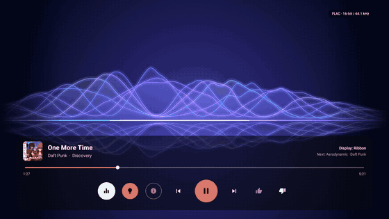
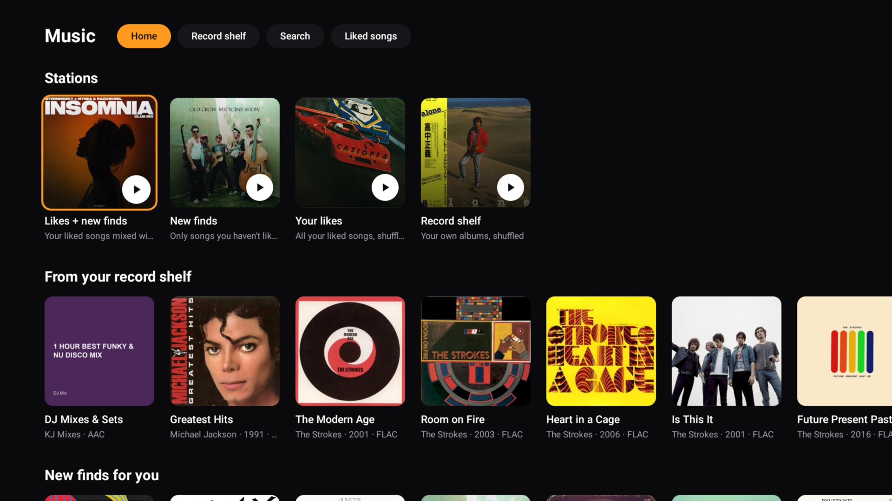
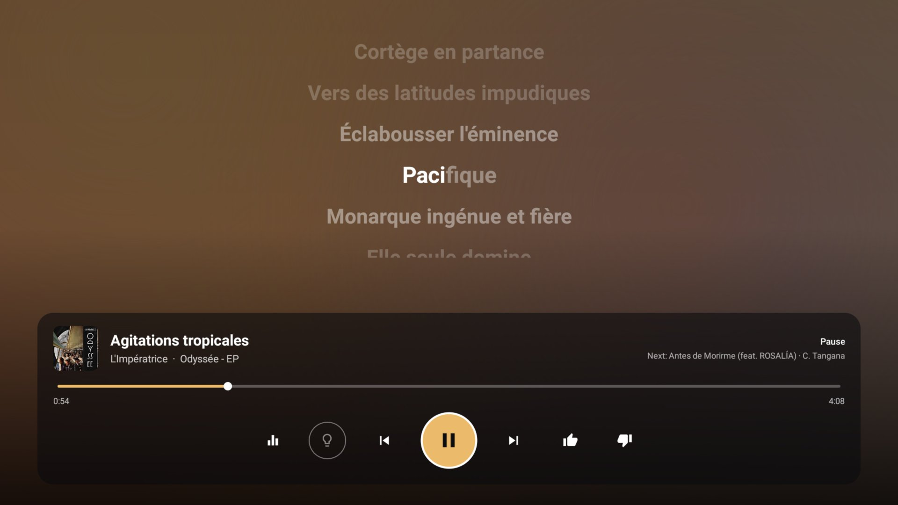
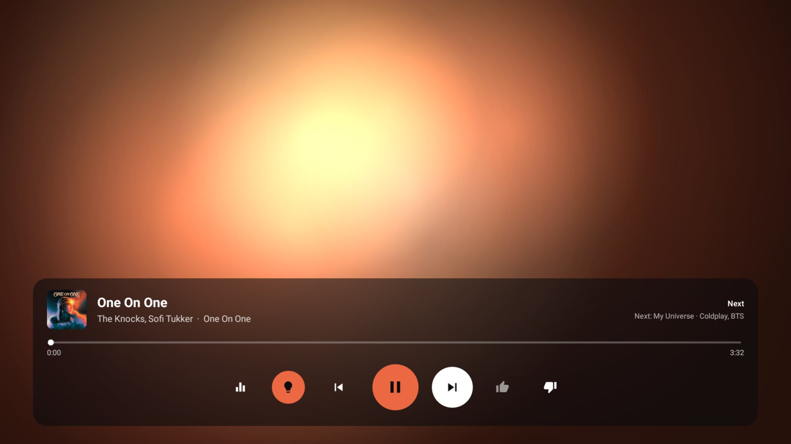
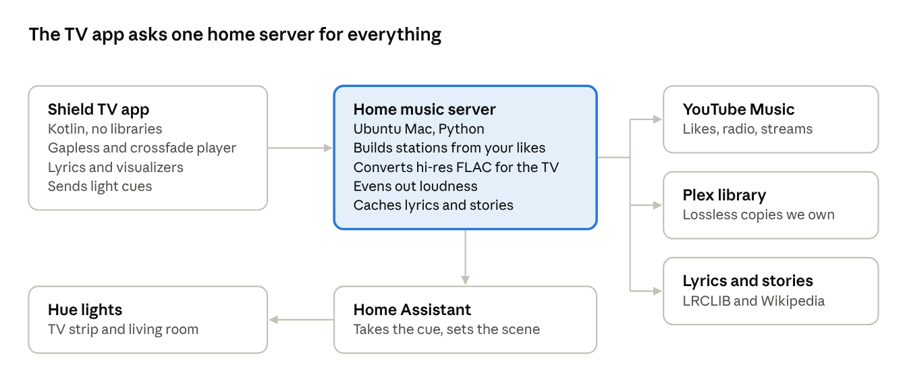

# Living Room Music

A calm, audio-only music app for Android TV (built for an NVIDIA Shield), with a small home server behind it.
It plays YouTube Music and a Plex library with no videos. It finds new music from your liked songs, shows synced
karaoke lyrics and four visualizers, and can colour the room's Hue lights to match each album through Home Assistant.

Personal home project. The YouTube Music side uses unofficial access (ytmusicapi, yt-dlp), so it is not a product
and isn't meant to be offered to others.







## How it works



| Folder | What's in it |
| --- | --- |
| `app/` | The TV app: Kotlin, no third-party libraries. Gapless albums, crossfades, even volume, lyrics, visualizers, calm mode |
| `server/` | `music.py`, the home server (Python, port 8097): stations from your likes, Plex, lyrics, album stories, loudness, light cues. `signin.py` saves the YouTube Music sign-in; `kids.py` and `ythistory.py` build the Kids tab |
| `homeassistant/` | The input boolean and automation that turn the server's MQTT cue into Hue scenes (only lights already on change, and the room is restored afterwards) |
| `tools/label_kids.py` | Sorts the family's YouTube watch history into kids' songs with Claude |
| `scripts/` | Install the server over ssh, build and install the TV app over adb |

## Portfolio materials

Everything for the write-up on mitchellv.me is in [`docs/portfolio`](docs/portfolio):

- [Case study](docs/portfolio/case-study.md) ([PDF](docs/portfolio/case-study.pdf)): the pitch, features, design process, engineering notes, shot list and captions
- [Screenshots](docs/portfolio/screenshots): nine captures straight from the TV (1920 × 1080)
- [Screen recordings](docs/portfolio/videos): eight clips recorded on the TV, listed in [CLIPS.txt](docs/portfolio/videos/CLIPS.txt). Best single clip: [06-visualizer-tour.mp4](docs/portfolio/videos/06-visualizer-tour.mp4)

## Setup

Server (a Linux box with Plex on the same machine, Python 3, node and ffmpeg):

1. Make `/srv/music` with a venv: `python3 -m venv /srv/music/venv`.
2. Put a shared secret in `~/.config/living-room-tv/hub.secret` and the Plex token in `~/.config/living-room-tv/plex.token`.
3. `MUSIC_HOST=<ssh-host> scripts/install-music.sh`
4. Sign in to YouTube Music once on the server: `/srv/music/venv/bin/python /srv/music/signin.py` and paste the request
   headers from music.youtube.com in your browser's developer tools.
5. For the lights: add `homeassistant/*.yaml` to Home Assistant, with an MQTT broker on the server.

TV (adb over the network enabled):

```
MUSIC_SERVER=http://<server-ip>:8097 scripts/deploy-music.sh <tv-ip> "living room"
```

Built with Claude Code.
