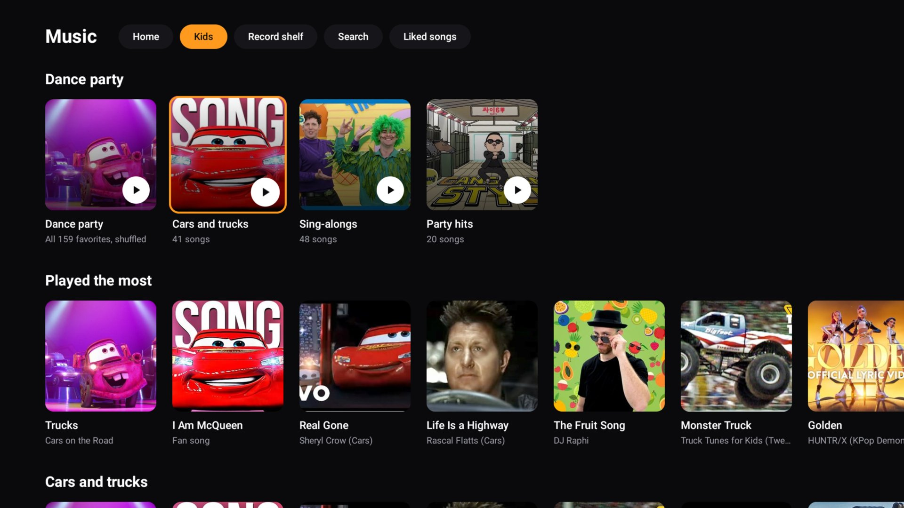
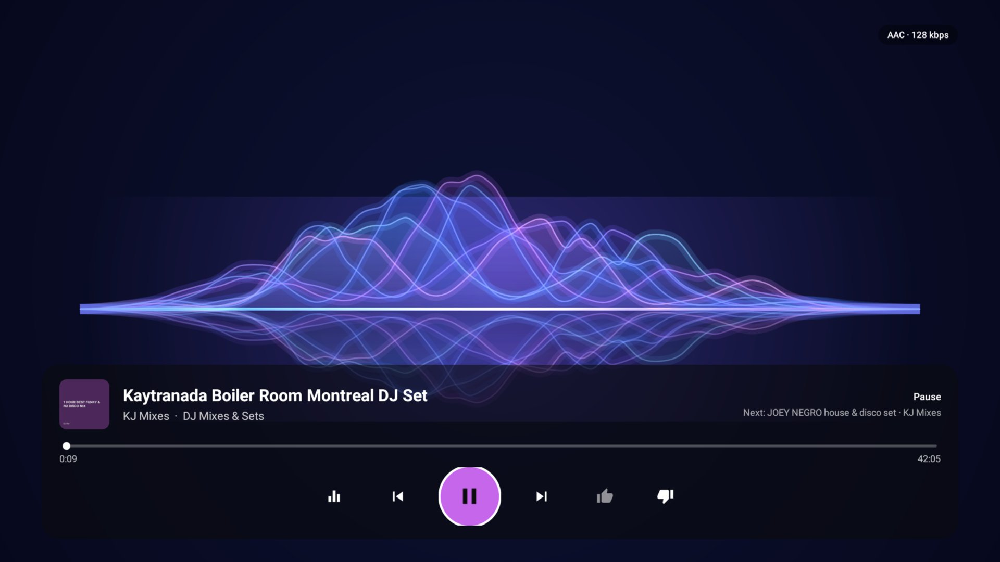
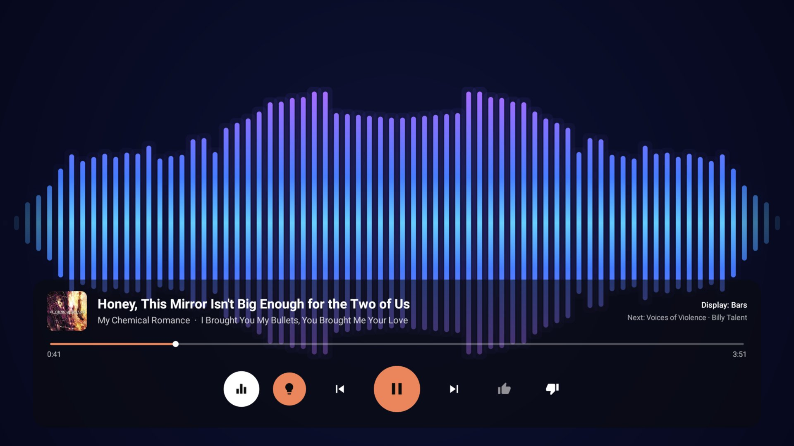
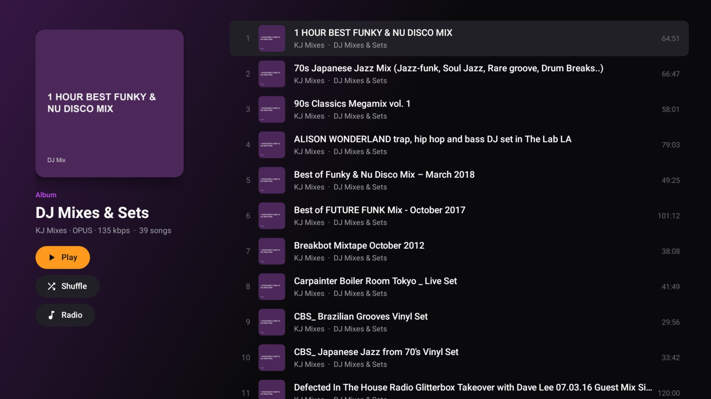
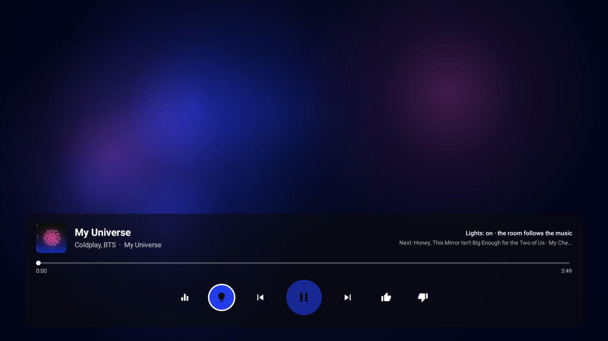

# Living Room Music

Oct 22, 2026 · @Mitchell

A portfolio case study and kit for mitchellv.me: copy, screenshots, a shot list and captions, ready to drop into the site.

## The pitch

**Living Room Music** — a calm, audio-only music app for our TV, built in a day.

Tagline: *Music for the room, not the screen.*

Summary for the top of the page: A custom Android TV app and home server that turn our living room into a listening room. It plays our streaming library and our own lossless Plex collection with no videos, lights the room in each album's colours through our Hue lights, and finds new music from what we already love. It has synced karaoke lyrics, four audio visualizers, gapless albums, and a kids' dance-party section built from what our family actually plays. I designed and directed it; it was built with Claude Code over one long day.

## Why I built it

We wanted music in the living room without a screen full of video. With two small kids, music videos on the TV meant more stimulation than we wanted, but the parents still wanted something good to listen to.

- **Calm by design:** sound only, never video; the screen settles to the album art, lyrics or a slow visual after a few seconds.
- **Better discovery:** the official app's suggestions felt thin; I wanted finds built from the songs we'd already liked, with a reason shown for each.
- **The record collection:** our TV runs into 70s vintage speakers, and I wanted our own FLAC library to play lossless next to streaming.
- **The kids:** a place for the songs they dance to (Lightning McQueen, The Wiggles, Gangnam Style) without opening YouTube.

## What it does

| Feature | What it means in the room |
| --- | --- |
| Sound only | Every song plays as audio; the TV never shows a video |
| Discovery from your likes | New finds ranked by how many of your liked songs lead to them, each with a "because you like…" reason |
| Your own library, lossless | Albums from Plex stream as the original FLAC; songs you own play from your file instead of the stream |
| Lights follow the music | The living room's Hue lights take each album's colours; they go back to how they were when the music stops |
| Album-coloured player | The whole screen washes in the cover's colours, and the accent colour follows the album |
| Karaoke lyrics | Synced lyrics, the current line filling left to right as it's sung |
| Four visualizers | Ribbon, aurora (in the same colours as the lights), particles and bars, all reacting to the music |
| Kids' dance party | The family's most-played kids' songs, found in our watch history and sorted with Claude |
| Popular and new | Charts, trending, "popular but new to you", and new releases from artists we already love |
| Listening craft | Gapless albums, crossfades between other songs, even volume across tracks |
| Calm mode | After 12 quiet seconds the controls fold away, leaving the art, lyrics or visual and the song's name |
| Time of day | Home opens with a mix that learns what we play in the morning, evening and at night |

## Design process

The look went through three passes in one day, each one a reaction to seeing the last one on the actual TV.

1. **Functional first.** A plain dark layout like the official mobile app, to prove playback, discovery and remote navigation worked.
2. **Vintage hi-fi (rejected).** Serif type, brass accents, record sleeves with vinyl sliding out, analog VU meters. It looked good, but it wasn't the feel I wanted for a family room.
3. **Modern and album-led (shipped).** I gathered references (Tidal, a modern music-app UI, a glowing waveform) and chose: an accent colour that adapts to each album, a full-bleed album-colour player with lyrics, and blue-violet visualizers.

Decisions that shaped it:

- **Built for a remote, not a mouse:** big focus states, a quick stop button on every screen, and two presses to thumbs-down, so a stray click can't throw a song away.
- **Quiet by default:** calm mode, soft fades at the screen edges, no hard cut-offs.
- **One brand:** a sunset gradient mark with five equalizer bars that move gently while music plays.

## Screenshots

All nine are captured straight from the TV (1920 × 1080) and sit in the Desktop folder with these names. Caption first, then alt text for the site.

**01 — Home.** Stations up top, then your own library and new finds. *Alt: The Living Room Music home screen on a TV, with rounded station cards and rows of album art on a near-black background.*

**02 — Kids.** The family's dance songs, found in our own watch history. *Alt: The Kids tab, showing Dance party, Cars and trucks, Sing-alongs and Party hits stations above a row of the most-played songs.*

**03 — Karaoke lyrics.** The line being sung fills left to right. *Alt: The player in the album's warm colours, with French lyrics centred and the current word half lit in white.*

**04 — Ribbon.** Glowing waves rising from a horizon line and mirrored below. *Alt: Layered blue and violet light ribbons reacting to music above the playback card.*

**05 — Aurora.** Soft light in the album's colours, the same colours the room's lights take. *Alt: Warm orange and gold clouds of light on screen, with the lights button lit in the album's orange.*

**06 — Bars.** Mirrored bars across the full width, fading softly at the edges. *Alt: Rows of rounded blue-to-violet bars mirrored about the centre line, moving to the music.*

**07 — Album page.** Art, a wash of its colour, and the track list. *Alt: An album page with the cover on the left, a round accent Play button and a numbered list of tracks.*

**08 — Brand.** The sunset equalizer mark and the tabs. *Alt: The Living Room Music logo, a gradient tile with five white bars, beside the Home, Popular, Kids, Plex and Liked songs tabs.*

**09 — Lights on.** The lights switch on, the aurora in blue and pink for a blue-and-pink cover. *Alt: Blue and magenta light clouds with the bulb button filled in blue, showing the lights are following the music.*

The TV only talks to one server in the house. That server signs in to YouTube Music, reads the Plex library, fetches lyrics and album stories, and passes light cues to Home Assistant, which only changes lights that are already on.

## Engineering highlights

The TV app is plain Kotlin with no third-party libraries; the server is Python on a home Linux box. These were the problems worth telling.

| Problem | What I did |
| --- | --- |
| Hi-res FLAC (24-bit / 192 kHz) distorted badly on the TV | The server converts anything above 16-bit / 48 kHz once (SoX resampler, dither) and caches it; the next song converts while the current one plays |
| Discovery that feels personal | Song radios seeded from about 40 liked songs; a song reached from several different likes ranks far higher than one reached once; skips and thumbs-down feed back in |
| Songs at different volumes | Every song is measured once (EBU R128 loudness) and played toward the same level; an album played straight through keeps one level, so its dynamics stay intact |
| Seamless listening | The next song is loaded before it's needed: same-album tracks hand off on the exact sample (gapless), others crossfade over 4 seconds, and skips are instant |
| Lights in the album's colours | The app sends each album's palette to Home Assistant, which colours only the lights already on and restores the room when the music stops |
| The kids' songs, from 7,000 watched videos | Claude sorted the watch history into kids' songs, family dance songs and everything else; play counts rank them |
| A visualizer that drew nothing | One sample at the screen's edge produced "not a number", which voided every wave; clamping it fixed the ribbon |
| Lyrics cut off mid-line | The lyric column was capped at the visible height; measuring it at full height and fading the edges fixed it |

## Video shot list

Shoot in the evening with the room lights already on (the light sync only changes lights that are on), phone on a tripod, TV brightness normal. Aim for 10–20 seconds a shot; the hero piece is shots 1–3 cut together.

| # | Shot | What to capture | Tip |
| --- | --- | --- | --- |
| 1 | The room changes colour | Wide shot of the room and TV; start an album and watch the lights fade into its colours | Pick a vivid cover (Purple Disco Machine, Coldplay's My Universe) |
| 2 | Song to song | Same framing; skip to a song with a very different cover | The 3-second light fade is the money moment |
| 3 | Aurora and the room | TV on Aurora with the lights following, screen and room in one frame | Shows the screen and the room in the same colours |
| 4 | Lights restore | Press Stop; the lights return to how they were | Proves it's considerate, not a gimmick |
| 5 | Kids' dance party | Start Dance party; the TV strip cycles colours | Film from behind the kids if they're in frame, or skip the kids |
| 6 | Karaoke lyrics | Close on the TV during a well-known chorus | Shoot straight on to avoid glare |
| 7 | Visualizer tour | Press Display through Ribbon, Aurora, Particles, Bars | Use a song with strong bass |
| 8 | Calm mode | Leave the remote down; controls fold away after 12 seconds | A slow push-in works well |
| 9 | The speakers | Close-up of the 70s speakers while FLAC plays, the format badge visible on screen | Ties in the lossless story |
| 10 | The remote | Hands navigating home, a row and the player | Shows it's built for a remote |

- [ ] Shots 1–4: the lights
- [ ] Shots 5–8: the app
- [ ] Shots 9–10: details

## Captions and short copy

**Project card (one line):** A calm, audio-only music app for our TV that lights the room in each album's colours.

**Short description (about 40 words):** Living Room Music is a custom Android TV app and home server. It plays streaming and our own lossless library with no videos, colours the room's Hue lights to match each album, and finds new music from what we already love.

**Video captions:**

- "Every album lights the room in its own colours."
- "No videos. Just music, lyrics and light."
- "Built in a day with Claude Code."
- "Our own FLAC collection, played bit for bit through 70s speakers."
- "The kids' dance party, made from the songs they actually play."

**Role line:** Product design, art direction and build direction by Mitchell Vizensky; built with Claude Code.

## Credits and a note on wording

- **Built with:** Claude Code (Anthropic), Kotlin for Android TV, Python, ffmpeg, Plex, Home Assistant and Philips Hue. Lyrics from LRCLIB and YouTube Music; album stories from Wikipedia.
- **Wording:** describe it as a personal project for our home. The streaming side uses unofficial access to YouTube Music, which is fine at home but not something to offer others, so the page shouldn't suggest it's a product or downloadable.
- **Brand:** use the Living Room Music sunset mark (screenshot 08), not the YouTube-Music-style tile on the TV's home row.
- **Privacy:** the screenshots show song titles and the kids' cartoon thumbnails, but no faces, names or addresses.

---
Live doc (with comments): https://claude.ai/artifact/PgkLZXMgf7giKsizb3gE7T
